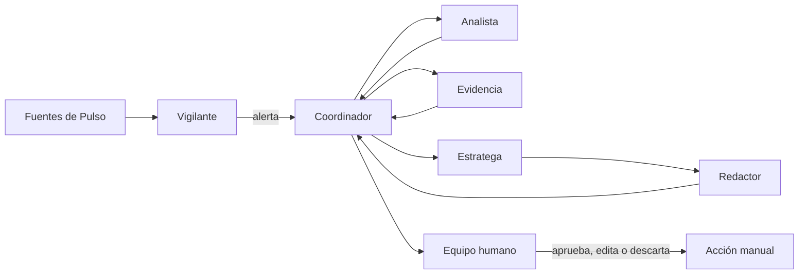

# Acción: equipo de agentes de crisis

La migración `deploy/crisis_agent.sql` se aplicó en pulso-demo el 2026-11-24. El job (`python -m pulso.crisis`) y la sección web Equipo de acción (ruta `/accion`) están publicados en main. **Todavía no está mergeada a main ni desplegada** (ni web ni cron): Leandro tiene que ver las capturas antes. El agente está prendido solo para axel-kicillof; pedro-sanchez sigue apagado. El tope por corrida es USD 0.50. El estado (approved/discarded) lo cambia una persona; nada se publica ni se postea solo.

La novedad no es un reporte más: es un **equipo de agentes que se coordinan hacia un solo objetivo**, que el equipo del candidato pueda actuar. El agente de crisis es la primera pieza de esa mesa. Una persona aprueba al final. Nada se publica solo. No usamos cuentas falsas ni respuestas en masa.

## Pitch (para una presentación)

Pulso no te deja solo con un reporte: cuando salta una alerta, varios agentes de IA se coordinan para un solo objetivo, que tu equipo pueda actuar. El Vigilante detecta el problema, el Analista explica qué pasó, quién lo empujó y qué alcance tuvo, el Estratega propone tres caminos y el Redactor deja los borradores listos por canal. Si hay una campaña coordinada, Evidencia arma el expediente para denunciarla a mano, nunca en automático. El Coordinador junta todo y te lo entrega; la última palabra es siempre de una persona, y no usamos cuentas falsas ni respuestas en masa.

## Roles

| Agente | Qué hace | Qué no hace |
|---|---|---|
| **Vigilante** | Mira volúmenes, relatos, pauta, IA y cuentas sospechosas, y dispara una alerta cuando hay un umbral real. | No escribe mensajes ni denuncia. |
| **Analista** | Diagnóstico: qué pasó, desde cuándo, piezas clave, quién amplificó, alcance, velocidad y relato. | No inventa hechos ni citas fuera de las menciones. |
| **Estratega** | Tres caminos (monitorear, aclarar, contrarrelato), quién debería responder y cuándo. | No elige solo el camino. |
| **Redactor** | Borradores por canal: post de X, guion corto de video, puntos para voceros. | No publica. |
| **Evidencia** | Si hay una campaña coordinada, arma el expediente para denunciarla a mano en la plataforma. | No denuncia, no reporta en lote, no scrapea. |
| **Coordinador** | Reparte el trabajo, junta el brief y se lo entrega al equipo. | No saltea la aprobación humana. |

El humano ve una sola bandeja, **Equipo de acción** (ruta `/c/[slug]/accion`). Ahí aprueba, edita, copia o descarta.

## Qué vimos en los datos reales (Kicillof, hora de Argentina)

Consulta de solo lectura sobre `pulso-demo`, al 24 de noviembre de 2026 a la mañana. Candidato `axel-kicillof`. Hay 3.635 menciones, todas clasificadas.

### El volumen general casi no sirve como única alarma

Negativas sobre el candidato (third_party, target = candidate, tono crítica / acusación / insulto):

| Día | Total | Mañana 0–10 | Tarde | Noche | X | Medios | YouTube |
|---|---:|---:|---:|---:|---:|---:|---:|
| 18/11 | 118 | 3 | 68 | 47 | 86 | 7 | 25 |
| 19/11 | 95 | 39 | 18 | 38 | 61 | 12 | 22 |
| 20/11 | 73 | 28 | 10 | 35 | 52 | 8 | 13 |
| 21/11 | 73 | 38 | 7 | 28 | 59 | 7 | 7 |
| 22/11 | 64 | 13 | 8 | 43 | 48 | 10 | 6 |
| 23/11 | 70 | 21 | 10 | 39 | 46 | 8 | 16 |
| 24/11 (hasta ~10:00) | 47 | 47 | 0 | 0 | 42 | 2 | 3 |

El 18 de noviembre coincide con el encendido de X: no se usa como crisis. Del 19 al 23 la media es 75 negativas por día, con un desvío de unos 12. Ningún día llega a un z-score de 2 (el 19 queda en ~1,7). La mañana del 24 ya suma 47, por encima de una media matinal de ~28 (z ~1,7), pero el día estaba incompleto.

Además, en X la mediana de impresiones de las críticas de los últimos 4 días es **9**. En 4 días hubo 269 críticas en X y solo 87 eran “notables” (medio, o X con 80+ impresiones / 5+ likes / 8.000+ seguidores, o YouTube con 200+ vistas). Un trigger que cuente menciones crudas se llena de ruido.

Los temas de la base son demasiado anchos: “gestión provincial” trae entre 26 y 49 negativas por día. Un z-score por tema no distingue un relato de otro.

### Lo que sí se puede disparar hoy

1. **Tema emergente / relato que crece.** Es el más útil con los datos de ahora. El cluster de la medida laboral y el rechazo de la Sociedad Rural tenía baseline 0 en los 7 días previos al 20 de noviembre, y después: 2, 6, 9, 12 y 5 (mañana del 24) menciones. En total 34 (23 negativas, 11 informativas), 13 medios —entre ellos LA NACION, Infobae y TN—, 20 posts de X y 1 video. En X, al recolectar, sumaban 8.774 impresiones, 118 likes y 27 reposts. Las métricas son una foto al recolectar y pueden estar bajas.

2. **Pico de negativas notables**, no de todas las menciones. Z-score ≥ 2 contra los 7 días completos posteriores a que una fuente lleve al menos 3 días estable, y un piso: 8 menciones notables o 3 medios distintos. Hoy este disparador casi no firearía, y está bien: evita el ruido.

3. **Campaña sospechosa.** Los datos alcanzan, pero hay que afinar el filtro. El detector ya marca coordinación. En este relato, 4 cuentas republicaron el titular de LA NACION (incluida `@LANACION`) y 3 compartieron un copypasta sobre pymes. Eso no es, por sí solo, una red de cuentas falsas. Hay que excluir la republicación de un medio y a la cuenta oficial de ese medio. El caso de 28 cuentas con el mismo texto a favor del candidato sí entraría, como alerta de coordinación, no necesariamente como “crisis en contra”.

4. **Suba de pauta en contra.** El 4 de noviembre se crearon 26 anuncios clasificados en contra; el 18, 12 (4 siguen activos). En los últimos días casi no hay anuncios nuevos en contra. El disparador se puede calcular; hoy no saltaría. Piso tentativo: 8 anuncios nuevos en contra en 48 horas, o un salto claro en el techo de gasto.

5. **Corrimiento de la IA.** Hay serie diaria desde el 18 de noviembre. El promedio diario fue de −6,1 a +2,8. “Polémicas” pasó de −30 a −40. Umbral tentativo: caída de 15 puntos en el promedio, o 20 puntos en una pregunta, sostenida dos días. Hoy no saltaría. Hace falta una semana de historia (Sánchez todavía no la tiene).

### Umbrales que proponemos (V1)

- Ventanas y baselines en la zona del candidato (Argentina o Madrid).
- Solo `account_relation = third_party`.
- **Notables:** medios (RSS o Google News), o X con ≥ 80 impresiones o ≥ 5 likes o ≥ 8.000 seguidores, o YouTube con ≥ 200 vistas.
- **Pico de negativas:** z ≥ 2 vs. 7 días completos, con la fuente ya estable 3 días, y piso de 8 notables o 3 medios.
- **Tema emergente:** baseline de 7 días < 1 mención del cluster, y en 48 horas ≥ 3 medios distintos, o ≥ 5 notables y ≥ 1.000 impresiones.
- **Campaña sospechosa:** ≥ 5 cuentas con señal de coordinación o ráfaga sobre el mismo texto en 24 horas, excluyendo medios de origen y la republicación de su titular.
- **Pauta en contra:** ≥ 8 anuncios nuevos `en_contra` en 48 horas, o z ≥ 2 del alta diaria con piso 8.
- **Corrimiento de la IA:** −15 en el promedio diario o −20 en una pregunta, sostenido 2 días, con al menos 7 fotos diarias.
- **Dedup:** la misma `trigger_type + trigger_key` actualiza la alerta si sigue en `new` o `in_review`. Se regenera el brief si aparecen ≥ 3 medios nuevos o el alcance se duplica.

El cluster de V1 se arma con huellas de titulares y palabras clave (el detector de sospechosas ya agrupa textos casi iguales). Los temas anchos de la base no alcanzan. Un agrupado con embeddings puede venir después.

## Ejemplo real

El brief de ejemplo está en `/workspace/pulso/crisis_brief_example_kicillof.md` (y una copia en `docs/crisis_brief_example_kicillof.md`). Se generó en local, con acceso de solo lectura a la base, sobre el relato laboral. Costo: **USD 0.002196** con `gpt-6-luna`.

Resumen: riesgo medio-alto, no por un pico general, sino porque el relato no existía y en cuatro días llegó a medios nacionales y a cámaras empresarias. Evidencia no armó un expediente de denuncia: las repeticiones son republicación de un medio y un copypasta chico. El Estratega deja tres caminos y el Redactor, los borradores, todos sujetos a que el equipo consiga el texto oficial de la medida (no está en los datos) y apruebe a mano.

Capturas del mock, no publicadas:

- `/workspace/pulso/screens/19-crisis-inbox.png` y `19-crisis-inbox-mobile.png`
- `/workspace/pulso/screens/19-crisis-brief.png` y `19-crisis-brief-mobile.png`
- `/workspace/pulso/screens/19-crisis-opciones.png`
- `/workspace/pulso/screens/19-crisis-agentes.png` (diagrama del equipo)

## Diseño técnico

### Modelo de datos (sin aplicar)

Ver `deploy/crisis_agent.sql`.

- `crisis_agent_settings`: enabled, tope de costo y de briefs por corrida, aviso por email. Por candidato, apagado por defecto.
- `crisis_alerts`: tipo, clave de dedup, ventana, severidad, métricas, estado `new | in_review | approved | discarded`, y quién cambió el estado.
- `crisis_briefs`: versiones, no se pisan. El JSON lleva la atribución de cada agente.
- `crisis_agent_runs`: auditoría del pase (rol, modelo, costo, resultado).
- `crisis_notifications`: V1 email; Slack y WhatsApp después.

RLS como en el resto de Pulso: `pulso_classifier` escribe; `authenticated` lee por `candidate_members` y solo actualiza el estado humano de la alerta; `anon` nada; se revocan los ALL por defecto de Supabase. El job no corre triggers con `auth.uid()`. El código no pisa un estado ya revisado.

### Pipeline en el cron

Después del clasificador, del detector de sospechosas, de la IA y de la clasificación de anuncios, si corresponde a la región. Un solo proceso, `python -m pulso.crisis`, no seis servicios pagos.

1. Coordinador arma el paquete de evidencia (SQL, sin LLM).
2. Vigilante evalúa umbrales (SQL, sin LLM).
3. Si hay alerta nueva o una actualización material, y queda presupuesto: Analista, Evidencia, Estratega y Redactor, en ese orden, con prompts distintos sobre el mismo paquete.
4. Coordinador guarda el brief, registra las corridas y, si está prendido, encola el email.
5. Tope `PULSO_CRISIS_AGENT_MAX_COST_USD` (default 0,50) y `max_briefs_per_run` (default 3). Flag `PULSO_CRISIS_AGENT_ENABLED=false`.

El contenido recolectado viaja como dato externo entre `<datos>`, nunca como instrucción. Sin herramientas. Sin publicación, sin llamada a APIs de las plataformas para denunciar o responder.

### Interfaz

Sección **Equipo de acción** en `/c/[slug]/accion`, con ítem en la navegación.

- Bandeja de alertas (nuevas, en revisión, aprobadas, descartadas).
- Vista del brief con el pase de agentes, piezas citadas y botones de copiar (post, guion, puntos).
- Acciones humanas: en revisión, aprobar, descartar, con nota opcional.
- En el tablero inicial, más adelante, una tarjeta “Acción” con las alertas abiertas. No hace falta en el primer corte.

### Notificaciones

V1: email al equipo de Active cuando entra una alerta `new`. Hoy no hay SMTP propio (está en el backlog, Resend). Hasta que esté, el aviso puede quedar encolado o salir por el canal que ya usemos con Leandro, sin inventar un envío. Después: Slack y WhatsApp, con el mismo criterio de no automatizar la respuesta pública.

### Modelo y costo

Precios ya usados en Pulso, verificados el 2026-11-18: `gpt-6-luna` a USD 0,10 / millón de tokens de entrada y USD 0,50 / millón de salida. Sin búsqueda web en este job (la búsqueda es lo que encarece la visibilidad en IA).

Este brief de ejemplo costó **USD 0,0022**. Un brief típico, con 20 a 40 menciones, debería quedar en esa misma magnitud, claramente por debajo de 1 centavo. Aunque el Coordinador haga varias llamadas (Analista, Estratega, Redactor, a veces Evidencia), una corrida completa debería quedar en torno a **USD 0,01 o menos**.

Estimación mensual, por candidato, con estos volúmenes:

- Días quietos: USD 0.
- 1 a 3 briefs por semana, si hay relatos nuevos: alrededor de USD 0,03 a 0,15 al mes.
- Tope de seguridad: USD 0,50 por corrida y, si se quiere, USD 1 por día. En la práctica no debería acercarse.

No hay precios inventados. Si se cambia de modelo, hay que cargar la tarifa como en `pulso.ai_visibility.cost`.

## Qué hay que aprobar antes de seguir

1. Aplicar `deploy/crisis_agent.sql` en pulso-demo (después de un backup).
2. Prender `PULSO_CRISIS_AGENT_ENABLED` y el setting del candidato (empezaría en Kicillof; Sánchez puede quedar apagado).
3. Publicar web (sección Acción) y recolector (el paso nuevo del cron). Auto-deploy sigue apagado: es un deploy explícito.
4. Confirmar los umbrales de arriba, o ajustarlos.
5. Quién puede cambiar el estado: hoy todos los `candidate_members` son `viewer`. Se puede dejar que el miembro apruebe, como en Sospechosas, o sumar un rol editor más adelante.
6. El email de aviso, cuando haya SMTP. No es bloqueante para mostrar la bandeja.

No se pide un servicio pago extra. El costo de IA es de centavos al mes, no de dólares, con estos volúmenes.

## Estimación de tiempo

- Migración, grants, tests y backup: medio día a 1 día.
- Vigilante (SQL, sin LLM) y Coordinador: 1 día.
- Analista, Estratega, Redactor y Evidencia (esta última, en V1, deja una conclusión y el paquete de pruebas; el expediente estilo Cyabra puede quedar para un segundo corte): 1 a 1,5 días.
- Sección Acción en la web (bandeja, brief, aprobar/copiar): 1,5 a 2 días.
- Aviso por email, cuando haya SMTP: medio día.
- Prueba con datos reales y ajustes de umbral: medio día.

**En una semana** se puede mostrar en una rama y, con la aprobación de arriba, publicar. Evidencia en versión expediente completo (priorización, PDF/CSV, políticas de cada red) es el trabajo de mitigación que ya estaba en el backlog; no hace falta para el primer corte.

## Límites que mantenemos

- Aprobación humana. Sin publicación automática.
- Sin cuentas falsas y sin respuestas en masa.
- Evidencia solo prepara la denuncia manual. Nada de reportes en lote ni scraping.
- El recolector se identifica con honestidad, como hasta ahora.
- No se imprimen secretos. El job no ve credenciales que no le corresponden, igual que el resto del cron.
