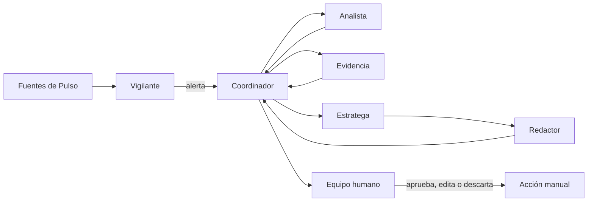

# Brief de ejemplo: Axel Kicillof

**Estado:** ejemplo local, no está guardado en la base ni publicado.
**Candidato:** Axel Kicillof
**Disparador:** tema emergente — control laboral / Sociedad Rural / pymes
**Ventana:** 20 de noviembre de 2026, 17:17 a 24 de noviembre de 2026, 10:07 (hora de Argentina, America/Buenos_Aires)
**Generado:** 24 de noviembre de 2026 (hora de Argentina)
**Modelo:** `gpt-6-luna` · **Costo de este brief:** USD 0.002196 (8564 tokens de entrada, 2680 de salida)
**Regla:** no se inventaron hechos ni citas; cada pieza cita una mención real de Pulso.
**Cómo se armó:** un Coordinador repartió el trabajo entre agentes con roles distintos y, al final, lo entrega a una persona para que lo apruebe, lo edite o lo descarte. Nada se publica solo.

---

## Pitch para presentar la herramienta

Pulso no te deja solo con un reporte: cuando salta una alerta, varios agentes de IA se coordinan para un solo objetivo, que tu equipo pueda actuar. El Vigilante detecta el problema, el Analista explica qué pasó, quién lo empujó y qué alcance tuvo, el Estratega propone tres caminos y el Redactor deja los borradores listos por canal. Si hay una campaña coordinada, Evidencia arma el expediente para denunciarla a mano, nunca en automático. El Coordinador junta todo y te lo entrega; la última palabra es siempre de una persona, y no usamos cuentas falsas ni respuestas en masa.

---

## Cómo se pasaron el trabajo en este brief

1. **Vigilante.** Detectó un tema emergente: el relato de la medida laboral y el rechazo de la Sociedad Rural tenía baseline 0 en los 7 días previos al 20 de noviembre, y después creció a 34 menciones, con 13 medios. El volumen general de críticas al candidato no llegó a un z-score de 2; el aviso es por este relato, no por un pico de todas las negativas.
2. **Analista.** Armó el diagnóstico: qué pasó, desde cuándo, el relato, el alcance, quién lo amplificó y las piezas clave, todas citadas.
3. **Evidencia.** Revisó las señales de cuentas sospechosas. Concluyó que no hay, en estos datos, una campaña de cuentas falsas que justifique un expediente de denuncia: 4 cuentas republicaron el titular de LA NACION (incluida la cuenta del medio) y 3 compartieron un texto casi idéntico sobre pymes, con alcance limitado. Dejó esa conclusión para el equipo; no armó un informe para las plataformas porque no corresponde.
4. **Estratega.** Propone tres caminos (monitorear, aclarar con datos, contrarrelato con voz propia), quién debería responder y cuándo.
5. **Redactor.** Escribió los borradores de cada opción: post de X, guion corto de video y puntos para voceros. Quedan para copiar, editar y aprobar.
6. **Coordinador.** Juntó las piezas en este brief y se lo entrega al equipo. La publicación, si la hay, la hace una persona.

---

## Nuevo trámite de información laboral: crece el rechazo empresario

**Nivel de riesgo:** Medio-alto

El relato emergió desde un baseline de cero menciones en los siete días previos al 20 de noviembre y sumó 34 menciones hasta las 10:07 del 24. Predominan las negativas (23), con cobertura de medios nacionales y rechazo de la Sociedad Rural y cámaras empresarias. El volumen general de críticas al candidato no registra un pico equivalente, por lo que el riesgo se concentra en este tema.

### Qué pasó

_Agente: Analista._

Se difundió que la Provincia exigiría a empresas informar sueldos y jornadas laborales, con referencias en publicaciones a un trámite mensual. La Sociedad Rural y entidades empresarias expresaron rechazo o preocupación, con argumentos de burocracia y posibles costos. Los datos no incluyen el texto oficial de la medida: no es posible confirmar desde este material su alcance, requisitos, plazos ni fundamento.

### Desde cuándo

_Agente: Analista._

Las primeras menciones del cluster aparecen el 20 de noviembre de 2026. El volumen diario pasó de 2 menciones ese día a 6 el 21, 9 el 22 y 12 el 23; hasta las 10:07 del 24 se registraron 5.

### El relato

_Agente: Analista._

La conversación instala la idea de una nueva carga administrativa para empleadores, especialmente pymes y empresas del campo. Se contrapone la supuesta obligación de informar salarios y jornadas con preocupaciones por burocracia y costos. La respuesta debería evitar dar por verificados detalles que no están en el texto oficial disponible en estos datos.

### Alcance y velocidad

_Agente: Analista._

Se contabilizan 34 menciones: 13 en medios, 20 en X y 1 en YouTube; 23 negativas y 11 informativas. X registraba 8.774 impresiones, 118 likes y 27 reposts al momento de la recolección. Es una foto de ese momento y las métricas pueden estar subestimadas. El cluster sigue activo: la mención más reciente relevada es del 24 de noviembre a las 10:07.

### Participación de cuentas sospechosas

_Agente: Evidencia, con los recuentos del Analista._

El detector marcó repetición, no una denuncia automática. Cuatro cuentas reprodujeron el mismo texto o uno casi idéntico del titular de LA NACION, incluida la propia cuenta del medio; esto es republicación de un titular y no evidencia suficiente de campaña coordinada de cuentas falsas. También hubo tres publicaciones casi idénticas contra el supuesto efecto sobre las pymes, pero con el alcance registrado no se puede afirmar que exista una red amplia de cuentas nuevas coordinadas.

### Piezas clave

_Agente: Analista._

- **LA NACION** (2026-11-22 19:29; publicación en X a las 21:24, Medio nacional): La nota informa preocupación empresaria por una medida que obligaría a informar sueldos y jornadas laborales. _La publicación de @LANACION en X registraba 3.799 impresiones, 12 likes, 4 reposts y 11 respuestas al recolectar._
  https://www.lanacion.com.ar/economia/fuerte-preocupacion-empresaria-por-una-medida-de-kicillof-que-obligara-a-informar-sueldos-y-jornadas-nid22112026/

- **Infobae.com** (2026-11-23 14:40, Medio nacional): Presenta la polémica por una nueva obligación atribuida al gobierno provincial y el rechazo de entidades empresariales. _La mención relevada no incluye métricas de alcance._
  https://www.infobae.com/economia/2026/11/23/polemica-por-una-nueva-obligacion-que-kicillof-impone-a-las-empresas-de-que-se-trata-y-por-que-la-rechazan/

- **TN** (2026-11-23 12:11 y 19:05, Medio nacional): TN publicó sobre el rechazo de la Sociedad Rural a las exigencias laborales y sobre el trámite obligatorio para empresas. _Las menciones relevadas no incluyen métricas de alcance._
  https://tn.com.ar/campo/2026/11/23/la-sociedad-rural-rechazo-las-nuevas-exigencias-laborales-de-la-provincia-de-buenos-aires/

- **Cámara Argentina de Comercio y Servicios (CAC), citada en un post de X** (2026-11-23 23:28, Cámara empresaria): Un post afirma que la CAC, la Sociedad Rural Argentina y otras cinco entidades empresarias bonaerenses cuestionaron una medida. El material no aporta un comunicado directo de esas entidades. _16 impresiones al recolectar._
  https://x.com/GuidoValsalva/status/2125053845210296649

- **LA NACION (@LANACION)** (2026-11-22 21:24, Post de mayor alcance en X): Difundió el titular sobre preocupación empresaria por la medida atribuida a Kicillof. _3.799 impresiones, 12 likes, 4 reposts y 11 respuestas al recolectar._
  https://x.com/LANACION/status/2124660297491521554

- **Impuestos&Equidad (@ImpuestosyE)** (2026-11-22 23:32, Post de mayor alcance en X entre los posts críticos identificados): Cuestionó con ironía la medida y retomó el encuadre de preocupación empresaria. _2.806 impresiones, 74 likes, 15 reposts y 3 respuestas al recolectar._
  https://x.com/ImpuestosyE/status/2124692650607456486

- **El Pyme (@ElPyme)** (2026-11-22 21:23, Post crítico sobre pymes): Cuestionó el supuesto trámite mensual sobre sueldos, pagos y jornadas para las pymes. _502 impresiones, 18 likes, 5 reposts y 1 respuesta al recolectar._
  https://x.com/ElPyme/status/2124660053210800372

### Quién lo amplificó

_Agente: Analista._

- Cobertura de medios nacionales, entre ellos LA NACION, Infobae y TN.
- Rechazo y preocupación atribuidos a la Sociedad Rural y a entidades empresarias.
- Cuentas de noticias y comentario político que replican el encuadre de más burocracia y costos.
- Tres cuentas publicaron un texto casi idéntico contra el supuesto efecto sobre las pymes; su alcance registrado fue limitado.

### Quién debería responder, y cuándo

_Agente: Estratega._

Si se confirma que hace falta responder, conviene que lo haga el área provincial responsable de la medida con información oficial; el candidato podría amplificar una explicación ya verificada, no reemplazarla.

Monitorear desde ahora y revisar la evolución durante el 24 de noviembre. Pasar a una aclaración cuando se verifique el texto oficial o si el cluster crece de forma sostenida; cualquier respuesta pública debe revisarse y aprobarse manualmente antes de difundirse.

### Tres opciones de respuesta

_Agentes: Estratega (los caminos) y Redactor (los borradores)._

Nada de esto se publica solo. Sirve para que el equipo lo revise, edite y apruebe a mano. No usamos cuentas falsas ni respuestas automáticas en masa.

#### Opción 1: Monitorear / no responder todavía

**Cuándo usarla:** Como primera opción mientras se verifica el texto oficial y no haya un salto relevante en menciones o alcance.

El tema emergió con rapidez, pero el volumen general de críticas al candidato no muestra un pico equivalente. Responder sin confirmar requisitos y alcance puede consolidar datos incompletos.

**Borrador para X**

> Borrador interno, no publicar: observar menciones, tono, alcance y nuevas publicaciones de medios; verificar si aparece el texto oficial y registrar preguntas concretas de empresas y cámaras.

**Guion corto de video**

No corresponde publicar un video en esta etapa. Internamente, preparar una lista de aspectos a verificar: qué información se pide, a quiénes alcanza, frecuencia y desde cuándo, sin completar esos datos por inferencia.

**Puntos para voceros**

- No amplificar por ahora el encuadre de polémica.
- Monitorear la evolución del cluster y las preguntas concretas.
- Conseguir y revisar el texto oficial antes de explicar la medida.

#### Opción 2: Aclaración o respuesta con datos

**Cuándo usarla:** Cuando el equipo tenga a mano y haya verificado el texto oficial de la medida y pueda responder las dudas concretas que circulan.

La conversación se apoya en afirmaciones sobre obligaciones mensuales, sueldos, jornadas, recibos y costos; los datos disponibles no permiten confirmar esos detalles. Una aclaración verificable puede separar lo confirmado de lo que todavía no está establecido en la información relevada.

**Borrador para X**

> Borrador sujeto a verificación y aprobación: “Estamos revisando las consultas sobre la información laboral que se informó en estos días. Vamos a compartir el texto oficial y explicar con claridad qué establece y a quiénes alcanza. No queremos responder con datos incompletos”.

**Guion corto de video**

Borrador sujeto a verificación y aprobación: “Escuchamos las dudas de empresas y entidades sobre la información laboral que se difundió. Antes de dar precisiones, vamos a poner a disposición el texto oficial y explicar qué establece, con información verificable. La conversación merece claridad y respuestas concretas”.

**Puntos para voceros**

- No presentar como confirmados plazos, alcance o documentación hasta verificar el texto oficial.
- Distinguir con claridad lo que establece el texto de las interpretaciones o preocupaciones expresadas.
- Reconocer las dudas planteadas por empresas y entidades, sin descalificarlas.

#### Opción 3: Contrarrelato con voz propia

**Cuándo usarla:** Solo después de verificar el texto oficial y si la conversación continúa instalando un encuadre crítico, con datos suficientes para explicarlo.

Puede permitir que el candidato comunique su propio criterio sobre la medida, sin responder a cada publicación ni tratar como ciertos argumentos que todavía no están comprobados en los datos disponibles.

**Borrador para X**

> Borrador sujeto a texto oficial y aprobación: “La discusión sobre cualquier requisito laboral tiene que darse con información clara. Vamos a explicar públicamente qué establece la medida y escuchar las observaciones de empresas y trabajadores, con datos y sin descalificaciones”.

**Guion corto de video**

Borrador sujeto a texto oficial y aprobación: “Hay preguntas legítimas sobre la información laboral que se difundió. Vamos a explicar el contenido de la medida con claridad y a escuchar las observaciones de empresas y trabajadores. El intercambio tiene que basarse en información verificable”.

**Puntos para voceros**

- Hablar en voz propia, sin convertir el mensaje en una confrontación con la Sociedad Rural o las pymes.
- Vincular cualquier explicación a datos confirmados en el texto oficial.
- Escuchar las observaciones empresarias sin afirmar detalles legales no verificados.

### Límites de esta foto

_Agente: Coordinador._

El corte es del 24 de noviembre de 2026, aproximadamente a las 11:05 de Argentina; el cluster llega hasta las 10:07. El texto oficial de la medida no está incluido, así que no se pueden confirmar su denominación, alcance, requisitos, plazos, entrada en vigencia ni efectos. Las métricas de X son una foto al recolectar y pueden estar subestimadas. Las repeticiones detectadas no bastan para afirmar una campaña coordinada de cuentas falsas.

---

## Cómo se eligió este caso

_Agente: Vigilante. Esta es la detección que disparó el resto del equipo._

Se miraron las menciones reales de Kicillof de los últimos días. El volumen general de críticas al candidato, una vez que X ya estaba activo (19 al 23 de noviembre), ronda las 64 a 95 negativas por día (media 75, desvío ~12). Ningún día llega a un z-score de 2. El 18 de noviembre (118 negativas) coincide con el encendido de X y no se usa como crisis.

El pico más claro no es ese total, sino un **relato nuevo**. El cluster de la medida laboral y el rechazo de la Sociedad Rural tenía baseline 0 en los 7 días previos al 20 de noviembre, y después creció así:

| Día (hora de Argentina) | Menciones del cluster | Medios | X | YouTube |
|---|---:|---:|---:|---:|
| 2026-11-20 | 2 | 2 | 0 | 0 |
| 2026-11-21 | 6 | 3 | 3 | 0 |
| 2026-11-22 | 9 | 1 | 8 | 0 |
| 2026-11-23 | 12 | 7 | 5 | 0 |
| 2026-11-24 | 5 | 0 | 4 | 1 |

En total: 34 menciones (23 con tono negativo, 11 informativas), 13 de medios, 20 de X y 1 de YouTube. En X, al momento de recolectar, sumaban 8.774 impresiones, 118 likes y 27 reposts.

## Anexo: menciones usadas

Las 34 menciones del cluster, en el orden en que se publicaron. Los textos están recortados.

- 2026-11-20 17:17 · Google News · Infocampo · tono: critica
  “Más burocracia”: la Sociedad Rural apuntó contra una medida laboral del gobierno de Kicillof - Infocampo
  https://www.infocampo.com.ar/mas-burocracia-la-sociedad-rural-apunto-contra-una-medida-laboral-del-gobierno-de-kicillof/

- 2026-11-20 17:34 · Google News · Bichos de Campo · tono: informativo
  ¿Futuro o pasado? La Sociedad Rural Argentina se molestó con las nuevas exigencias de información laboral (incluyendo los recibos salariales) del gobierno de Axel Kicillof - Bichos de Campo
  https://bichosdecampo.com/futuro-o-pasado-la-sociedad-rural-argentina-se-molesto-con-las-nuevas-exigencias-de-informacion-laboral-incluyendo-los-recibos-salariales-del-gobierno-de-axel-kicillof/

- 2026-11-21 04:49 · X · NewsDigitales · tono: critica · 430 impresiones, 0 likes, 0 reposts, 616178 seguidores
  La Sociedad Rural rechazó una medida de Kicillof y advirtió por más costos para el campo https://t.co/E7gcF3bFO6
  https://x.com/NewsDigitalesAr/status/2124047640094499025

- 2026-11-21 07:47 · Google News · AgroLatam · tono: critica
  Kicillof suma burocracia al campo: la Rural denuncia nuevas trabas al empleo bonaerense - AgroLatam
  https://www.agrolatam.com/argentina/actualidad/kicillof-suma-burocracia-al-campo-la-rural-denuncia-nuevas-trabas-al-empleo-bonaerense/

- 2026-11-21 07:53 · Google News · La Tecla · tono: critica
  La Sociedad Rural puso el grito en el cielo por los controles de Kicillof a los empleadores - La Tecla
  https://www.latecla.info/171340-la-sociedad-rural-puso-el-grito-en-el-cielo-por-los-controles-de-kicillof-a-los-empleadores

- 2026-11-21 08:41 · X · Politicar · tono: informativo · 0 impresiones, 0 likes, 0 reposts, 164 seguidores
  Kicillof obliga a informar sueldos y jornadas cada mes y la Rural le marca la cancha https://t.co/zlEpfepvYP
  https://x.com/politicar_ok/status/2124105969395278163

- 2026-11-21 13:07 · Google News · Diario UNO Arrecifes · tono: critica
  La Sociedad Rural explotó contra los nuevos controles impuestos por Kicillof - Diario UNO Arrecifes
  https://unoarrecifes.com/la-sociedad-rural-exploto-contra-los-nuevos-controles-impuestos-por-kicillof/

- 2026-11-21 23:22 · X · Todo en uno. · tono: critica · 4 impresiones, 0 likes, 0 reposts, 149 seguidores
  @edufeiok, acá tenés el riesgo país, ni la Gestapo se animó a tanto. ¿Futuro o pasado? La Sociedad Rural Argentina se molestó con las nuevas exigencias de información laboral (incluyendo los recibos salariales) del gobie
  https://x.com/libreelecccion/status/2124327681952993629

- 2026-11-22 03:01 · X · Ariel Biagetti · tono: critica · 10 impresiones, 0 likes, 0 reposts, 3689 seguidores
  La Sociedad Rural rechazó los nuevos controles laborales de Kicillof  https://t.co/3hjt0rmfW9
  https://x.com/biagettiariel/status/2124382802087231600

- 2026-11-22 19:29 · Google News · La Nación · tono: critica
  Fuerte preocupación empresaria por una medida de Kicillof que obligará a informar sueldos y jornadas laborales - La Nación
  https://www.lanacion.com.ar/economia/fuerte-preocupacion-empresaria-por-una-medida-de-kicillof-que-obligara-a-informar-sueldos-y-jornadas-nid22112026/

- 2026-11-22 20:55 · X · Alejandro Ullua · tono: informativo · 11 impresiones, 0 likes, 0 reposts, 4503 seguidores
  Fuerte preocupación empresaria por una medida de Kicillof que obligará a informar sueldos y jornadas laborales. Los empleadores deberán declarar todos los meses cuánto pagaron en salarios y cómo controlan las horas traba
  https://x.com/aleullua/status/2124653111759470719

- 2026-11-22 21:23 · X · El Pyme · tono: critica · 502 impresiones, 18 likes, 5 reposts, 5173 seguidores
  🚨 Mientras las PyMEs luchan por sobrevivir, Kicillof suma en la provincia de Buenos Aires un nuevo trámite obligatorio: F.U.T.U.R.O., una declaración jurada mensual sobre sueldos, pagos y jornadas laborales, con posibles
  https://x.com/ElPyme/status/2124660053210800372

- 2026-11-22 21:24 · X · LA NACION · tono: critica · 3799 impresiones, 12 likes, 4 reposts, 3881541 seguidores
  Fuerte preocupación empresaria por una medida de Kicillof que obligará a informar sueldos y jornadas laborales https://t.co/dsHK9LPapj
  https://x.com/LANACION/status/2124660297491521554

- 2026-11-22 21:45 · X · Fernando · tono: insulto · 1 impresiones, 0 likes, 0 reposts, 9 seguidores
  LA NACION - Fuerte preocupación empresaria por una medida de Kicillof que obligará a informar sueldos y jornadas laborales - https://t.co/A6rtkWCwHz Este es el comunista protegido por @LANACION @clarincom por la inmensa 
  https://x.com/Fernand61002470/status/2124665624420827383

- 2026-11-22 21:56 · X · RULY · tono: informativo · 41 impresiones, 0 likes, 0 reposts, 27060 seguidores
  Fuerte preocupación empresaria por una medida de Kicillof que obligará a informar sueldos y jornadas laborales https://t.co/iUXIZ6LiqP #NoVotesPeromismo
  https://x.com/Ruly1961/status/2124668487612129333

- 2026-11-22 22:01 · X · CADENA INFORMATIVA · tono: informativo · 31 impresiones, 0 likes, 0 reposts, 22882 seguidores
  Fuerte preocupación empresaria por una medida de Kicillof que obligará a informar sueldos y jornadas laborales  https://t.co/TFu27VEI6K
  https://x.com/cadenainforma/status/2124669529255293382

- 2026-11-22 23:32 · X · Impuestos&Equidad · tono: critica · 2806 impresiones, 74 likes, 15 reposts, 96105 seguidores
  ELECCIÓN ASEGURADA 😂 ATENCIÓN ‼️ A KICI SE LE OCURRIÓ UNA IDEA...  Surge una fuerte preocupación empresaria por una medida de Kicillof que obligará a informar sueldos y jornadas laborales.  Los empleadores deberán declar
  https://x.com/ImpuestosyE/status/2124692650607456486

- 2026-11-23 01:45 · Google News · Diario El Día de La Plata · tono: informativo
  Alarma en las empresas por una medida de Kicillof que exige informar sueldos y horarios - Diario El Día de La Plata
  https://www.eldia.com/politica-y-economia/cuestionamiento-empresarial-a-un-control-laboral-de-la-provincia-politica-y-economia_1795409104

- 2026-11-23 06:58 · Google News · La Trocha · tono: critica
  La Sociedad Rural salió al cruce de Kicillof por un nuevo control laboral - La Trocha
  https://www.latrochadigital.com.ar/2026/11/23/la-sociedad-rural-salio-al-cruce-de-kicillof-por-un-nuevo-control-laboral/

- 2026-11-23 07:16 · X · PRIMICIA VIRTUAL ORIGINAL · tono: informativo · 4 impresiones, 0 likes, 0 reposts, 168 seguidores
  Fuerte preocupación empresaria por una medida de Kicillof que obligará a informar sueldos y jornadas laborales - LA NACION https://t.co/mQHwJMqdwF
  https://x.com/fernandez_17230/status/2124809234214752709

- 2026-11-23 08:44 · Google News · La Plata 1 · tono: critica
  Kicillof exigirá a las empresas informar sueldos y horarios todos los meses: empresarios denuncian más burocracia y costos - La Plata 1
  https://www.laplata1.com/2026-11-23/kicillof-exigira-a-las-empresas-informar-sueldos-y-horarios-todos-los-meses-empresarios-denuncian-mas-burocracia-y-costos-127290/

- 2026-11-23 09:22 · Google News · Punto Capital Noticias · tono: informativo
  Kicillof exigirá a las empresas bonaerenses un informe mensual sobre salarios y jornadas laborales - Punto Capital Noticias
  https://www.puntocapitalnoticias.com/kicillof-exigira-a-las-empresas-bonaerenses-un-informe-mensual-sobre-salarios-y-jornadas-laborales/

- 2026-11-23 12:11 · Medios (RSS) · Todo Noticias · tono: critica
  La Sociedad Rural rechazó las nuevas exigencias laborales de la provincia de Buenos Aires
  https://tn.com.ar/campo/2026/11/23/la-sociedad-rural-rechazo-las-nuevas-exigencias-laborales-de-la-provincia-de-buenos-aires/

- 2026-11-23 14:40 · Medios (RSS) · Infobae.com · tono: informativo
  Polémica por una nueva obligación que Kicillof impone a las empresas: de qué se trata y por qué la rechazan
  https://www.infobae.com/economia/2026/11/23/polemica-por-una-nueva-obligacion-que-kicillof-impone-a-las-empresas-de-que-se-trata-y-por-que-la-rechazan/

- 2026-11-23 19:05 · Google News · TN · tono: informativo
  Kicillof aprobó un nuevo trámite obligatorio para las empresas de PBA: de qué se trata y por qué generó polémica - TN
  https://tn.com.ar/economia/2026/11/23/kicillof-aprobo-un-nuevo-tramite-obligatorio-para-las-empresas-de-pba-de-que-se-trata-y-por-que-genero-polemica/

- 2026-11-23 23:04 · X · Pyme Arg · tono: insulto · 1 impresiones, 0 likes, 0 reposts, 464 seguidores
  Insufrible la burocracia de Kicillof. Suficiente con que están bajas las ventas para que el burocrata nos aumente el costo con sus pavadas https://t.co/vpv0qamnHd
  https://x.com/PymeArg/status/2125047873121247284

- 2026-11-23 23:28 · X · GU↑D● · tono: insulto · 16 impresiones, 0 likes, 0 reposts, 8906 seguidores
  La Cámara Argentina de Comercio y Servicios (CAC), la Sociedad Rural Argentina (SRA) y otras cinco entidades empresarias bonaerenses cuestionaron una medida de gobierno del inútil de @Kicillofok que, haciéndose el Mao Ze
  https://x.com/GuidoValsalva/status/2125053845210296649

- 2026-11-23 23:30 · X · BREAK POINT · tono: critica · 366 impresiones, 13 likes, 2 reposts, 55686 seguidores
  🔴 ¡KICILLOF SUMA BUROCRACIA Y AHOGA A LAS PYMES QUE PIDEN DAR MARCHA ATRÁS! 📋 Exige a todas las empresas presentar mensualmente salarios, recibos y documentación laboral, duplicando trámites y sumando costos administrati
  https://x.com/BreakPointMP/status/2125054295058076028

- 2026-11-23 23:42 · X · Alerta 140 📢 · tono: informativo · 274 impresiones, 1 likes, 0 reposts, 65112 seguidores
  🚨🇦🇷 #AHORA | PBA: Kicillof impulsa una nueva regulación laboral que genera rechazo empresarial 📋 Desde enero de 2027, las empresas deberán informar mensualmente datos sobre salarios y jornadas laborales. 🏢 La Sociedad Ru
  https://x.com/Alerta140/status/2125057323139793314

- 2026-11-24 05:45 · X · Pelado TV - Fan · tono: critica · 36 impresiones, 0 likes, 0 reposts, 11551 seguidores
  🔴 KICILLOF SUMA BUROCRACIA Y AHOGA A LAS PYMES QUE PIDEN DAR MARCHA ATRÁS 📋Exige a todas las empresas presentar mensualmente salarios, recibos y documentación laboral, DUPLICANDO trámites y sumando COSTOS ADMINISTRATIVOS
  https://x.com/PeladoTVFan/status/2125148733977346360

- 2026-11-24 06:04 · X · ChpalaAbrazo · tono: critica · 5 impresiones, 0 likes, 1 reposts, 312 seguidores
  Y acá en provincia de Buenos Aires  el señor Axel Kicillof quiere poner más trabas u burocracia con leyes que afectan a todas las empresas, es una pena vivir en una provincia que podría ser rica en inversiones y sentirse
  https://x.com/ChuplaAbrazo/status/2125153528926666863

- 2026-11-24 06:36 · X · NewsDigitales · tono: critica · 422 impresiones, 0 likes, 0 reposts, 616002 seguidores
  La Sociedad Rural rechazó una medida de Kicillof y advirtió por más costos para el campo https://t.co/74i44eWATy
  https://x.com/NewsDigitalesAr/status/2125161701431562468

- 2026-11-24 09:08 · X · Sergio Palahy Sosa · tono: critica · 15 impresiones, 0 likes, 0 reposts, 3728 seguidores
  🔴 KICILLOF SUMA BUROCRACIA Y AHOGA A LAS PYMES QUE PIDEN DAR MARCHA ATRÁS 📋 Exige a todas las empresas presentar mensualmente salarios, recibos y documentación laboral, duplicando trámites y sumando costos administrativo
  https://x.com/PalahySosa/status/2125199971594952808

- 2026-11-24 10:07 · YouTube · Rugido Salteño · tono: critica
  KICILLOF SUMA UN NUEVO TRÁMITE OBLIGATORIO PARA LAS PYMES BONAERENSES
  https://www.youtube.com/watch?v=jPJ3J2-W5-Y
